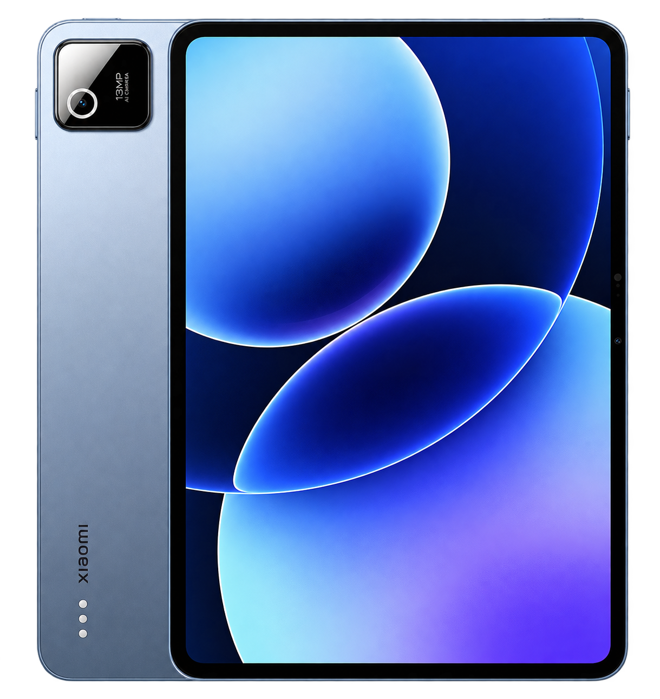

# Device tree for Xiaomi Pad 8 (`yupei`)

  

## Device specifications

| Component | Specification |
| :--- | :--- |
| Model | Xiaomi Pad 8 (25097RP43G) |
| Codename | `yupei` |
| SoC | Qualcomm Snapdragon 8s Gen 4 |
| CPU | Octa-core: 1× Cortex-X4 at 3.2 GHz, 3× Cortex-A720 at 3.0 GHz, 2× Cortex-A720 at 2.8 GHz, 2× Cortex-A720 at 2.0 GHz |
| GPU | Adreno 825 |
| Memory | 8 GB LPDDR5X / 12 GB LPDDR5T |
| Storage | 128 GB UFS 3.1 / 256 GB UFS 4.1; no microSD |
| Display | 11.2-inch LCD, 3200 × 2136, up to 144 Hz, 3:2 |
| Battery | 9,200 mAh; 45 W charging |
| Rear camera | 13 MP, f/2.2, autofocus, flash |
| Front camera | 8 MP, f/2.28, fixed focus |
| Audio | Four speakers, Dolby Atmos; four microphones |
| Connectivity | Wi-Fi 7, Bluetooth 6.0 |
| Ports | USB-C (USB 3.2 Gen 1, 5 Gbps, DisplayPort 1.2, audio and charging), keyboard connector |
| Dimensions | 251.22 × 173.42 × 5.75 mm |
| Weight | Approximately 485 g |
| Shipped Android version | Android 16 |
| Shipped kernel version | Linux 6.6.118 |

Hardware configurations and connectivity support vary by region. Dimensions and weight refer to the standard display version. Specifications: [Xiaomi Global](https://www.mi.com/global/product/xiaomi-pad-8/specs/), [Xiaomi FAQ](https://www.mi.com/global/support/faq/details/KA-667473/) and [Xiaomi India](https://www.mi.com/in/product/xiaomi-pad-8/specs/).
